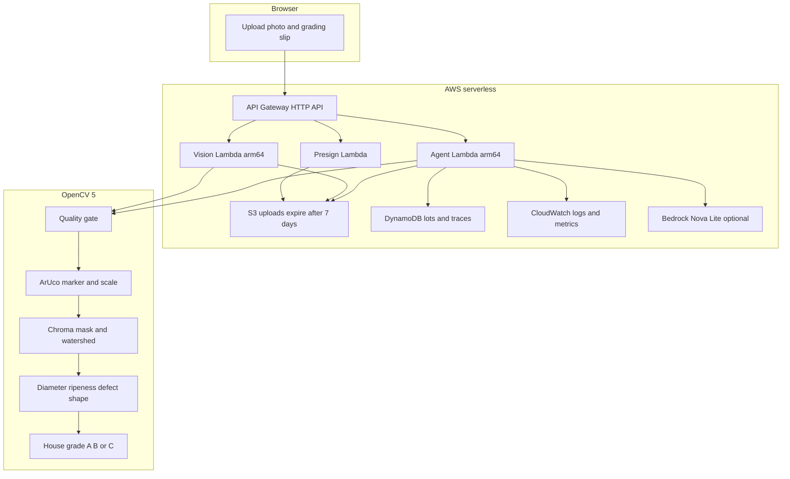

# MandiLens technical report

Aman Tebriwal, GitHub amantebriwal4321.
OpenCV AI Competition 2026, solo entry.
The numbers below are from painted trays with a known marker. They are not a field trial.

## Problem

At a small mandi, a lot of tomatoes is graded by eye in a few seconds. The farmer has nothing to point at if the price comes back low, and grade C fruit often gets dumped instead of sent to a processing unit. A phone photo plus a printed square should be enough to measure size, ripeness, and damage, and to refuse the photo when the shot is bad.

## Who it is for

The person holding the phone is a farmer, a commission agent, or a grader at the stall. They are not setting up a server. They put fruit on a plain light tray, drop the 50 mm marker in frame, and take one photo from above. The slip tells them the grade of each fruit and where the lot should go: the mandi, local retail, or a processing unit.

A second person is the reviewer. If a fruit is cut off or sitting on a band boundary, the agent stops and asks them to accept or override the grade before anything is routed.

## Architecture

The browser uploads a photo to a local FastAPI app, or, after deploy, to API Gateway. Two Lambda functions on arm64 run the same Python package: one only inspects, one runs the agent. Photos land in a private S3 bucket through a presigned PUT and expire after 7 days. Lots and the agent trace go to DynamoDB. Logs and embedded metrics go to CloudWatch. Bedrock is optional. The rule planner is the path that is tested.



The same diagram is exported at `docs/architecture.png`. The agent loop is `docs/agent_flow.png`.

Locally there is no AWS. FastAPI calls the pipeline in process and keeps the lot in memory. `GET /api/health` reports the OpenCV version so you can see that 5.x is actually loaded.

## OpenCV 5 implementation

Package pin: `opencv-python-headless==5.0.0.93`. The marker API in use is `cv.aruco.ArucoDetector` with `DICT_4X4_50`, id 0. That class is the OpenCV 5 path. The rest of the work is also OpenCV: Laplacian, Lab and HSV conversion, morphology, distance transform, watershed, `fitEllipse` inputs via contours, `minEnclosingCircle`, and perspective warp when it is actually needed.

Stages, in order:

1. Quality, on the original photo. Blur is the variance of the Laplacian after a contrast stretch, so a dark sharp photo is not called blurry. The cutoff is 80. Exposure is mean gray, accepted from 85 to 235. Glare is the share of near white pixels outside the marker box, cutoff 1.5 percent.
2. Marker. The largest ArUco square wins. Millimetres per pixel are `50 / side_px` of the black square. If the opposite sides differ by 18 percent or more, the photo is warped so the marker becomes a square. If the marker is already close to a square, the photo is not warped. A homography fit to a marker that is only a pixel off square bends the rest of the tray and invents diameter error. I measured that failure and then stopped doing it.
3. Segment. Chroma in Lab has to clear the median chroma of the frame by 14, and at least 18. That keeps a warm cast on a gray tray from painting the whole image as fruit. Holes inside a fruit (a dark bruise drops chroma) are filled. Touching fruit are split with a distance transform and `cv.watershed`, one component at a time, so a big fruit does not set the peak threshold for a small one.
4. Measure. Diameter is the min enclosing circle, converted with the marker scale. Ripeness is the hue inside the mask: red, turning, or green. Defect percent is pixels much darker than the median L inside the fruit. Solidity is contour area over hull area.
5. Grade. House bands, stated here so nobody confuses them with a government grade.
   Size: A from 55 mm up, B from 40 mm up to 55, C under 40.
   Defect: A under 4 percent, B from 4 percent up to 12, C from 12 percent up.
   The worse of the two bands wins. Solidity under 0.78 drops the grade one step.
   Confidence starts at 0.94. A fruit that touches the frame loses 0.34. Unknown ripeness, a rough outline, or a measurement within 2 mm or 1 defect point of a band also costs confidence. Under 0.70 the agent will not route.

Fruit under about 22 mm are dropped as noise.

## The agent

The loop is capped at 6 steps. Every step stores the tool name, why it ran, and the vision metrics that caused it.

Tools: `inspect`, `enhance` (`sharpen` or `gamma`), `request_retake`, `ask_human`, `record_lot`, `route_lot`.

The rule planner reads the last inspect and picks the next tool.

- Blur under 80: sharpen once, inspect again, then retake if it is still soft.
- Brightness under 85: gamma once, inspect again, then retake if it is still dark.
- No marker, glare, or a tray whose median chroma is over 46: retake, with a specific sentence. A red tray is the chroma case. The pipeline would rather say it cannot see the fruit than invent grades.
- Any fruit under 0.70 confidence: `ask_human`, and do not route.
- Otherwise record the lot and route it.

Routing uses the grades, not a vibe. If 30 percent or more of the lot is C, it goes to processing. If none are C and at least 60 percent are A, it goes to the mandi. Anything else is local retail.

A person can accept the proposed grade or override it to A, B, or C. The route is computed again from the new grades. That second route is a new step in the trace. On the cut off sample, accepting the low confidence fruit sends the lot to the mandi. Overriding it to C sends the lot to local retail.

Bedrock Converse is implemented against the same six tools (`src/mandilens/agent/bedrock.py`). It stays off unless `BEDROCK_ENABLED=true`. If the call fails, the loop records that and uses the rule planner. The model is not allowed to route when the last inspect failed the quality gate, or while a review is open. The grades still decide the destination, even if the model names a different one. I have not run Bedrock in this account. The tested planner is the rule one. A chatbot that explains a fixed grade would not be this loop: the blur score, the brightness, and the confidence are what pick the next tool. Sample traces are in `docs/eval/traces/`.

## AWS deployment

`template.yaml` is a SAM app. `sam validate --lint` passes. It has not been deployed.

- HTTP API with a throttle of 10 requests per second and a burst of 20.
- Health and presign Lambdas do not load OpenCV.
- Vision and agent Lambdas are Python 3.12, arm64, 1536 MB, 60 second timeout, X Ray on. They share an OpenCV 5 layer built for arm64.
- S3 bucket, encryption on, public access blocked, lifecycle deletes `uploads/` after 7 days. The browser gets a 5 minute presigned PUT.
- DynamoDB on demand, point in time recovery, encryption on. The item is the lot id.
- IAM is per function. Presign can `s3:PutObject` only under `uploads/`. Vision and the agent can `s3:GetObject` only under that prefix. The agent can read and write the lots table and call `bedrock:InvokeModel` on the configured model id. Metric writes are limited to the `MandiLens` namespace.
- `BEDROCK_ENABLED` defaults to false. Model id parameter defaults to `amazon.nova-lite-v1:0`.
- Structured stage timings are on the API response. On Lambda, retake and human review counts are emitted as Embedded Metric Format.

Build, when you are ready and Docker can build arm64:

```bash
sam build --use-container
sam deploy --guided
```

## Evaluation

Dataset: 24 frontal painted trays, seed 2026, 114 fruit that do not touch, plus a separate gate set and a 14 case agent set. Ground truth is the circle that was drawn and the hue it was painted with. Sizes in the 24 tray set sit off the 40 mm and 55 mm lines (35, 42, 50, 58, 66, 74 mm), so this pass does not stress the exact boundary. A fruit within 2 mm of a band loses confidence on purpose.

From `docs/eval/results.json`:

- Count: 24 of 24 images, every fruit found, none extra.
- Diameter MAE 0.29 mm, 95th percentile absolute error 0.48 mm.
- Grade accuracy 1.00 on 114 fruit. Confusion is 38 A, 45 B, 31 C, all on the diagonal.
- Ripeness accuracy 1.00 on the same fruit (red, turning, green).
- Quality gate: 5 of 5 bad shots refused (blur, glare, missing marker, red tray, dark), 0 of 8 good shots refused.

Agent against a single inspect, 14 cases:

- Agent 14 of 14. It routes clean lots, lifts a dark photo with gamma and then routes, retakes blur, glare, a missing marker, and a red tray, and stops on the cut off fruit.
- Single pass 12 of 14. It refuses the dark photo instead of fixing it, and it routes the cut off fruit without asking.

The gap is the point of the loop. A single pass either bails or ships. The agent uses the first inspect to choose enhance, retake, or a human.

Failure cases, with pictures:

- `docs/eval/soft_focus.jpg`. Gaussian blur. Blur score stays under 80 after one sharpen. The trace is inspect, enhance, inspect, request_retake. No grades are returned.
- `docs/eval/red_tray.jpg`. Median chroma is about 66, over the cutoff of 46. The agent asks for a plain light tray. It does not grade the red circles on the red cloth.
- Two fruit that touch are split in the morning sample (6 fruit, including a pair). A heavy overlap, more than a light touch, can still merge. The benchmark trays do not include that case.
- Shoot from above. The marker is only used as a full homography when it is clearly a trapezoid. A steep angle with a small marker in the corner does not contain a stable plane estimate, and pretending it does makes diameters worse.

## Limits

- Painted fruit are round, evenly colored, and sitting on a flat gray tray. Real tomatoes have calyxes, shine, and odd shapes. Field MAE is unknown until someone shoots a tray and measures it with a ruler.
- The bands are ours. Do not print them on a bill as an official grade.
- Green fruit on a green cloth, or red fruit on a red crate, fails closed only when the whole frame is colorful. A small colored patch can still confuse the mask.
- One marker in the corner cannot rescue a very oblique photo.
- Defect percent is "darker than the rest of this fruit", not a trained bruise class. A stem scar can look like a bruise.
- The local server keeps lots in memory. Restart and they are gone. Lambda stores the lot without the JPEG, because DynamoDB items should stay small.

## Responsible use

This grades produce in a photo. It is not a medical device, not a legal weighment, and not a reason to underpay someone. The human review step exists so a low confidence fruit is not priced by a circle fit.

On AWS, uploads are private and deleted after 7 days. The local demo does not write photos to disk. `cv.imdecode` drops EXIF from the pixels it grades, but a presigned upload stores the original file until the lifecycle rule deletes it. Do not photograph people to test it.

Throttling, encryption, blocked public access, and least privilege IAM are in the template. `AllowedOrigin` defaults to `*` for a demo. Change that before any real stall uses a deployed URL. Bedrock is off until you turn it on, and the fallback does not pretend the model ran.

## What I would do next

Shoot about 30 tomatoes with the printed marker, measure diameters with a ruler, and replace the painted MAE with that error. Then onion and potato, which are less kind to a chroma mask. A small segmentation model can wait until those photos exist. Grade C lots are the ones worth pushing into a surplus or processing route, which is the Kisan Setu idea, but that wiring is not in this repo.
